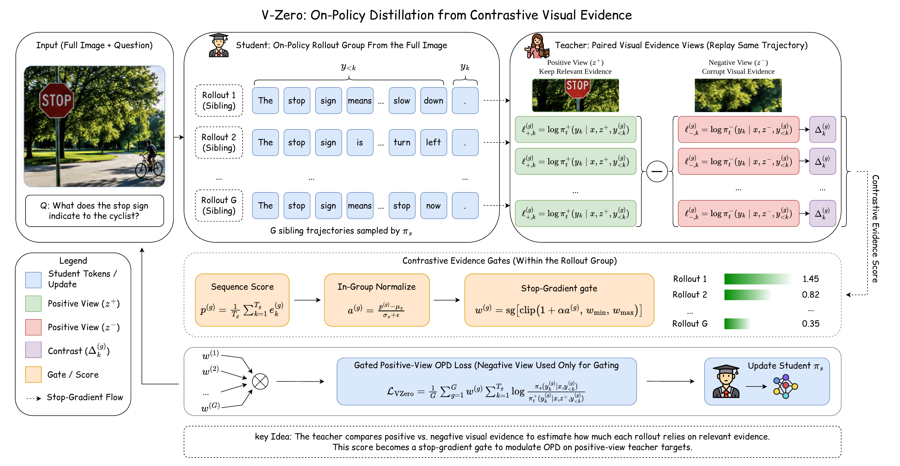

# V-Zero

**V-Zero: Answer-Label-Free On-Policy Distillation with Contrastive Evidence Gating for Fine-Grained Visual Reasoning**

[[Paper]](https://arxiv.org/abs/2606.25319) [[Model]](https://huggingface.co/hao05/v-zero-4b) [[Dataset]](https://huggingface.co/datasets/hao05/v-zero-5k)

## Overview

V-Zero improves fine-grained visual reasoning without annotated answer labels. The student model samples on-policy reasoning trajectories from the full image, while a teacher model replays the same trajectories with paired positive and negative visual evidence views. By contrasting teacher support under the task-relevant crop and an irrelevant crop, V-Zero estimates how well each trajectory is grounded in visual evidence and uses this signal to gate dense token-level distillation. The resulting training objective keeps standard full-image inference unchanged while providing answer-label-free supervision for localized visual reasoning.

<p align="center">
  
</p>

## Dataset

The V-Zero-5K dataset is publicly available on Hugging Face: [`hao05/v-zero-5k`](https://huggingface.co/datasets/hao05/v-zero-5k).

## Environment

The base dependency set is pinned in [`requirements.txt`](requirements.txt), exported from the AutoDL experiment environment. It targets Linux x86_64, Python 3.12.13, and CUDA 13.0. Run the following commands from the repository root:

```bash
conda create -n v-zero python=3.12.13 -y
conda activate v-zero
python -m pip install uv==0.11.18
uv pip install --no-deps -r requirements.txt
uv pip install -e . --no-deps
```

All direct and transitive packages are already listed, so `--no-deps` preserves the exact versions and intentional overrides used by the experiment image. The repository also includes its `hf-xet` development wheel because that version is no longer available from a public package index; only unused debug symbols were stripped to keep the repository small. The pinned PyTorch, vLLM, FlashAttention, FlashInfer, and `hf-xet` wheels are Linux-specific and require an x86_64 host with an NVIDIA driver compatible with CUDA 13.0.

When using the original AutoDL image, activate its existing environment and only repoint the editable repository installation:

```bash
conda activate verl
uv pip install -e . --no-deps
```

The default FA3 training launcher additionally requires a shared `.venv` runtime,
its Python base installation, and pre-populated model and kernel caches. Installing
these dependencies alone does not prepare that runtime; follow the
[FA3 setup and launch guide](scripts/README.md#fa3-training-through-the-main-launcher).

## Training

The V-Zero training implementation is included under [`verl/`](verl/), with the public launcher in [`scripts/run_vzero_qwen35_vl_fsdp.sh`](scripts/run_vzero_qwen35_vl_fsdp.sh). It configures the on-policy distillation recipe with teacher replay, positive/negative evidence crops, and evidence-gated token distillation.

The main training entry defaults to FA3 training. Run `--prepare` once, then
`--launch` on **each allocated node**. The default `FA3_PROFILE=four_b` uses two
nodes; `nine_b` uses four. Each node uses eight GPUs, split equally between student
and teacher. Both profiles retain the baseline training behavior;
`four_b_boundary` explicitly selects a separate packed-sequence boundary variant.

The default recipe uses batch size 32, mini-batch size 16, eight rollouts, learning
rate `1e-6`, 100 training steps and model-only checkpoints every ten steps. Configure
`TOTAL_TRAINING_STEPS` and `SAVE_FREQ` before preparation to change the duration.
See [the training guide](scripts/README.md) for shared runtime requirements, data
fields, per-node commands, output records and the optional direct FA2 route.

## Annotation

The annotation tools support positive grounding, geometric nearby negatives, and blank/black negatives:

| Task | Entry point |
| --- | --- |
| Positive bbox / point | `annotation/label.sh` |
| Nearby negative crops (same size, IoU 0–5%) | `annotation/generate_nearby_negative.sh` |
| Same-size black negative images | `python -m annotation.black_crops` |

See [the annotation guide](annotation/README.md) for environment setup, API configuration, input requirements, and runnable examples. The guide covers positive annotation, geometric nearby crops, and blank/black crops.

## Evaluation

The evaluation framework is included under [`eval/`](eval/), with launch helpers in [`scripts/start_vllm_server.sh`](scripts/start_vllm_server.sh) and [`scripts/eval_benchmarks.sh`](scripts/eval_benchmarks.sh). Copy the Seed judge template and fill local credentials before running judge-based evaluation:

```bash
cp .seed.env.example .seed.env
```

Start the vLLM OpenAI-compatible server:

```bash
bash scripts/start_vllm_server.sh \
  --model "/path/to/model" \
  --served-model-name vzero \
  --port 8000 \
  --tensor-parallel-size 1 \
  --data-parallel-size 8
```

Run benchmark evaluation from another terminal:

```bash
bash scripts/eval_benchmarks.sh \
  --dataset mmvp \
  --model "/path/to/model" \
  --served-model-name vzero \
  --data-root "/path/to/benchmarks" \
  --output-dir results/mmvp-run1 \
  --engine vllm_server \
  --vllm-server-base-url http://127.0.0.1:8000/v1 \
  --vllm-server-request-concurrency 512 \
  --eval-batch-size 512 \
  --vllm-server-timeout 1200 \
  --vllm-server-max-retries 0 \
  --enable-thinking \
  --no-resume
```

## TODO

- [x] Release training code
- [x] Release data preparation scripts
- [x] Release evaluation scripts
- [x] Release model checkpoints
- [x] Release the V-Zero-5K dataset
- [x] Document training setup, launch commands and evaluation entry points

## License

This project is released under the Apache License 2.0.
